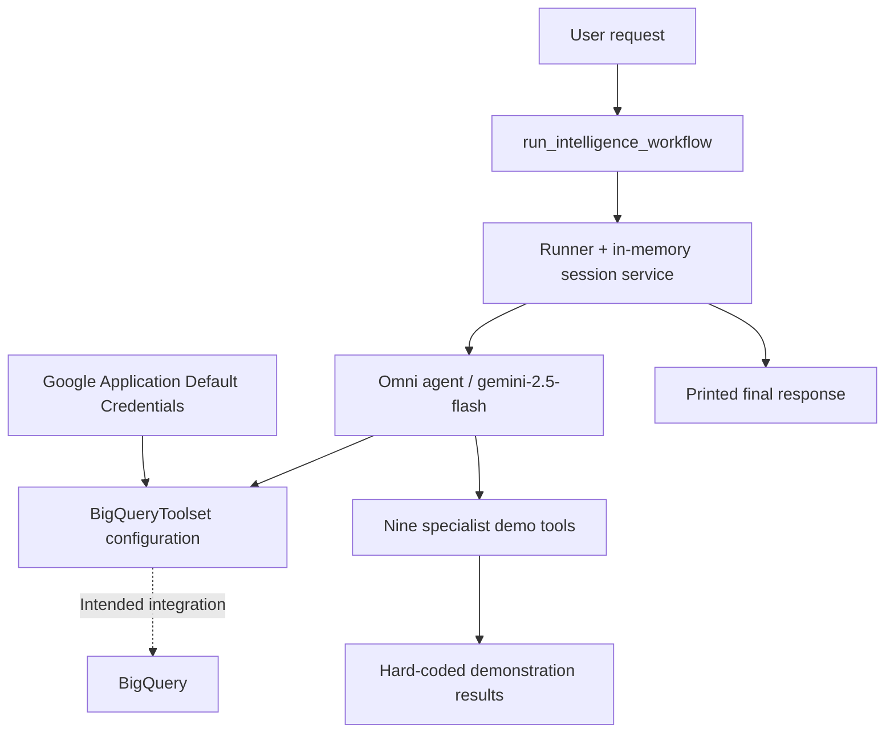

# Omni-Data Intelligence Agent

A Python prototype for a unified, Gemini-powered assistant that routes BigQuery questions to tools for analytics, data quality, query optimization, governance, and reporting.

**Project status: architecture prototype.** The repository contains agent configuration, a proposed BigQuery integration, nine demonstration tools, and an asynchronous entry point. It is not yet a runnable, production-ready application: the imported `adk_core` and `adk_integrations` modules are not provided, and their dependency versions are not specified. The specialist tools return fixed example messages rather than inspecting real data.

## What it is designed to do

Instead of switching between separate data operations assistants, a user submits a natural-language request to one agent. The agent is instructed to select relevant tools, combine their outputs, and explain its findings.

For example, the included scenario asks the agent to investigate a revenue drop, check the `orders` table's data quality, and identify expensive queries in one workflow.

## Capabilities and implementation status

| # | Capability | Tool / integration | Current implementation |
| --- | --- | --- | --- |
| 1 | Natural-language questions and SQL execution | `BigQueryToolset` | Configuration references an external integration; not verified against a real runtime. |
| 2 | SQL optimization | `optimize_and_profile_sql` | Fixed optimization advice and a demo savings percentage. No profiling or dry run. |
| 3 | Data quality | `audit_table_data_quality` | Returns the table name with fixed example quality results. No table scan. |
| 4 | Cost analysis | `track_slot_and_billing_inefficiencies` | Fixed billing observation. No billing or job-history query. |
| 5 | Pipeline monitoring and recovery | `check_pipeline_health_and_recover` | Returns a simulated recovery message. No pipeline inspection or retry. |
| 6 | Data discovery | `search_data_catalog_semantically` | Fixed example table relationship. No catalog lookup or semantic index. |
| 7 | Predictive analytics | `execute_bqml_forecasting` | Returns the requested metric/timeline with a demo score. No model training or forecast. |
| 8 | Security and governance | `scan_pii_and_audit_access` | Fixed example findings. No PII scan or IAM audit. |
| 9 | Executive reporting | `generate_narrative_executive_brief` | Fixed revenue narrative; the supplied scope does not affect the result. |
| 10 | Root cause analysis | `diagnose_kpi_variance_anomalies` | Returns the KPI name with a fixed explanation. No statistical investigation. |

**Demo figures are not measurements.** Values such as estimated savings, null ratios, revenue growth, and forecasting scores are literal strings in the code. They must not be treated as evidence about a connected dataset.

## Architecture



### Main components

- **Authentication:** `google.auth.default()` obtains credentials and a project ID at module import time. Credentials are passed to `BigQueryCredentialsConfig`; the returned `project_id` is currently unused.
- **BigQuery tool configuration:** `BigQueryToolConfig(write_mode="BLOCKED")` expresses an intent to block writes. Its behavior depends on the missing integration and has not been validated.
- **Specialist toolset:** `omni_bigquery_intelligence_kit` groups the nine custom `Tool` objects.
- **Agent:** `omni_bigquery_intelligence_agent` uses the model identifier `gemini-2.5-flash` and instructions that map requests to ten capability categories.
- **Workflow:** each call to `run_intelligence_workflow(user_request)` constructs a new `InMemorySessionService` and `Runner`, awaits `runner.run(input_text=...)`, and prints `response.output_text`.

These constructor and runner signatures are assumptions of this prototype, not a verified compatibility claim for an official Google ADK release.

## Repository layout

```text
Omni-Data-Intelligence-Agent/
├── agent.py       # Authentication, tools, agent instructions, and demo workflow
├── README.md      # Scope, architecture, setup requirements, and implementation roadmap
└── .gitignore     # Python caches, local environments, credentials, and generated files
```

There is currently no web interface, API server, database migration, container image, dependency lockfile, CI workflow, or automated test suite.

## Setup and runtime requirements

### 1. Clone and create an isolated Python environment

```sh
git clone https://github.com/RAK0152/Omni-Data-Intelligence-Agent.git
cd Omni-Data-Intelligence-Agent
python3 -m venv .venv
source .venv/bin/activate
```

On Windows PowerShell, activate with `.venv\Scripts\Activate.ps1`.

A supported Python version must be selected alongside the eventual runtime dependencies; this repository does not yet establish a tested minimum version.

### 2. Resolve the agent framework dependencies

The code currently imports:

```python
from google.auth import default
from adk_core import Agent, Tool, Toolset, Runner, InMemorySessionService
from adk_integrations.bigquery import (
    BigQueryToolset,
    BigQueryCredentialsConfig,
    BigQueryToolConfig,
)
```

`google.auth` is supplied by `google-auth`, but the other two modules have no installation instructions or implementation in this repository. Installing `google-auth` alone will not make the application runnable. Do not infer package names from these imports and install similarly named packages without verifying their source.

Before execution, either supply the intended framework modules or migrate the prototype to a verified ADK API. Confirm the tool constructors, model configuration, session initialization, runner invocation, and response extraction, then add a pinned dependency manifest. No speculative `requirements.txt` is included.

### 3. Configure Google Cloud and model access

Once the runtime integration is resolved, the deployment will need:

- A Google Cloud project with access to the intended BigQuery datasets.
- Application Default Credentials available to `google.auth.default()`.
- Read/query permissions appropriate to the selected datasets and billing project.
- Gemini access and the model authentication configuration required by the chosen framework.

The prototype does not define model API keys, a location, a billing project override, or a dotenv loader. A `.env` file alone is therefore not loaded by this code. Supplying Google credentials does not by itself resolve the missing framework or model configuration.

### 4. Run the included scenario after resolving those prerequisites

```sh
python agent.py
```

The hard-coded request is:

> Our daily revenue dropped by 15% yesterday. Analyze the root cause, verify the data quality of the 'orders' table to rule out corruption, and check if there are any slow, expensive queries hurting performance.

To change the scenario, edit `complex_prompt` in the `if __name__ == "__main__"` block. There is no command-line argument parser.

For integration into another Python script, the intended interface is:

```python
import asyncio
from agent import run_intelligence_workflow

asyncio.run(run_intelligence_workflow(
    "Review data quality for my_project.analytics.orders."
))
```

Importing `agent` triggers authentication and agent construction immediately. The workflow prints its response and does not return a structured result. Notebook and other existing async environments should await the coroutine rather than start a second event loop.

## Example requests for future implementation

These illustrate routing intent, not completed functionality:

- “Which datasets contain order and conversion data?”
- “Inspect nulls and duplicate order IDs in `my_project.analytics.orders`.”
- “Profile this query and suggest ways to reduce bytes scanned.”
- “Explain yesterday's revenue drop and separate data-quality issues from business changes.”
- “Summarize weekly sales performance in an executive brief.”

## Validation

A dependency-free syntax check can be run from the project root:

```sh
python3 -c "import ast; from pathlib import Path; ast.parse(Path('agent.py').read_text()); print('Python syntax OK')"
```

This checks Python syntax only. It does not import dependencies, authenticate, contact Gemini or BigQuery, validate framework compatibility, or exercise tools. End-to-end execution and cloud permissions remain unverified.

## Limitations and operational considerations

- **Simulated analytics:** nine tools produce examples, including success messages for operations they do not perform. The agent instructions currently describe broader functionality than those tools implement.
- **Unverified runtime:** framework imports and execution signatures require resolution before use.
- **Write protection:** `write_mode="BLOCKED"` is configured but untested. Pipeline recovery and model creation would also conflict with a strictly read-only workflow if later implemented.
- **Query costs:** a read-only query can still incur compute costs. No application-level query budget, dry-run gate, timeout, or scan limit is implemented.
- **Data handling:** prompts and tool results may be sent to the configured model by the chosen runtime. No redaction, retention policy, or data classification controls are implemented here.
- **Sessions:** a new in-memory session service is constructed for each invocation; persistent history is not configured.
- **Reliability:** no retries, structured logging, exception recovery, concurrency controls, or monitoring are implemented.
- **Credentials:** keep credentials, service-account keys, and local secrets outside version control. `.gitignore` excludes common local credential locations, but is not a secret detector.

## Implementation roadmap

1. Replace unresolved framework imports with a verified runtime and pin dependencies.
2. Make configuration explicit and defer authentication until application startup.
3. Establish a working Gemini and read-only BigQuery path using a small test dataset.
4. Replace demo messages with evidence-backed tool results; label unavailable operations clearly.
5. Add parameter validation, fully qualified table identifiers, query budgets, and structured errors.
6. Separate read-only analytics from any future write/recovery operations and their permissions.
7. Add unit tests for routing/tool contracts and opt-in integration tests for cloud calls.
8. Add persistent sessions, observability, and a CLI or API interface as needed.

## Contributing

Keep changes small and distinguish demonstrated behavior from planned behavior. For each implemented tool, document its inputs, actual data sources, outputs, permissions, cost implications, and tests. Never substitute fabricated statistics for real results in production paths.

## License

No license has been selected for this repository. Add an appropriate license before distributing or reusing it under explicit open-source terms.
